# p-14172 연습문제 (70강 ~ 79강)

- 시작 코드: [jhs512/p-14172-2](https://github.com/jhs512/p-14172-2)의 `068` 커밋 시점
- 과제 설명: https://www.slog.gg/p/14172 (4부, 69강 ~ 79강)
- 개발 환경: Java 25, Spring Boot 4.1, Spring Data JPA, H2

## 진행 방식

모든 문제는 **TDD(테스트 주도 개발)** 로 풉니다.

1. **RED**: 원하는 동작을 테스트로 먼저 적습니다. 구현이 없으니 테스트는 실패합니다.
2. **GREEN**: 테스트를 통과하는 최소한의 코드를 작성합니다.
3. 필요하면 테스트를 하나 더 추가(RED)하고 다시 구현(GREEN)합니다.

커밋마다 `./gradlew test` 실행 결과를 이미지로 남겼습니다(`docs/images/`).

## 공통 규칙 (문제 전제)

- 로그인 기능 없이 주소에 `?actorId=회원번호`를 붙여 "누가 요청했는지"를 알립니다.
- actorId가 없거나 존재하지 않는 회원이면 `401` / `{"resultCode": "401-1", "msg": "로그인 후 이용해주세요."}`
- 본인 글/댓글이 아닌데 수정·삭제하려 하면 `403` / `{"resultCode": "403-1", "msg": "권한이 없습니다."}`

---

## 문제 1: 회원가입 API

`POST /api/v1/members/join`

### 커밋 1: 테스트 먼저 작성 (RED)

**변경 파일**: `src/test/java/com/back/domain/member/member/controller/ApiV1MemberControllerTest.java` (새 파일)

- `t1` 회원가입 성공: 응답 상태 `201`, `resultCode` `201-1`, 메시지 `새유저님 환영합니다. 회원가입이 완료되었습니다.`를 기대합니다. 가입 후 DB에서 `findByUsername`으로 회원을 다시 찾아 이름이 저장됐는지도 확인합니다.
- `t2` 요청 본문 제약 위반: username이 3글자(`abc`)면 `Size(4, 30)` 위반으로 `400-1`이 나와야 합니다.
- 테스트 클래스의 어노테이션
  - `@ActiveProfiles("test")`: 메모리 DB를 쓰는 테스트 설정을 사용합니다.
  - `@SpringBootTest`: 스프링 앱 전체를 띄워서 테스트합니다.
  - `@AutoConfigureMockMvc`: 서버를 실제로 띄우지 않고 HTTP 요청을 흉내 내는 `MockMvc`를 준비합니다.
  - `@Transactional`: 테스트가 끝나면 DB 변경을 롤백해서 테스트끼리 서로 영향을 주지 않게 합니다.

**결과**: `Member`, `MemberService`, `ApiV1MemberController`가 아직 없어서 컴파일부터 실패합니다(RED).

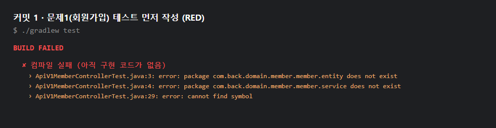

### 커밋 2: Member 엔티티 ~ 컨트롤러 구현 (GREEN)

요청이 처리되는 흐름: **컨트롤러 → 서비스 → 리포지터리 → DB**

**변경 파일 (모두 새 파일)**

| 파일 | 역할 |
|---|---|
| `member/entity/Member.java` | DB `member` 테이블과 연결되는 클래스. `username`(중복 불가), `password`, `name` |
| `member/repository/MemberRepository.java` | DB 접근. `findByUsername`은 메서드 이름만으로 스프링이 SQL을 만들어 줌 |
| `member/service/MemberService.java` | 업무 로직. `join`은 `Member`를 만들어 저장 |
| `member/controller/ApiV1MemberController.java` | HTTP 입구. `POST /api/v1/members/join` |

**핵심 포인트**

- `Member extends BaseEntity`: 번호(id), 생성일, 수정일은 068 코드의 `BaseEntity`가 이미 처리하므로 회원 고유 정보만 가집니다.
- `@Column(unique = true)`: DB 수준에서 username 중복을 막는 안전장치입니다.
- `MemberJoinReqBody`(record): 요청 JSON을 담는 그릇입니다. `@Size(min = 4, max = 30)` 같은 제약을 필드에 붙입니다.
- `@RequestBody @Valid`: 요청 JSON을 객체로 바꾸고 제약을 검사합니다. 어기면 기존 `GlobalExceptionHandler`가 `400-1`로 응답합니다.
- 상태 코드 `201`은 컨트롤러가 직접 정하지 않습니다. 068 코드의 `ResponseAspect`가 `RsData`의 `resultCode` 앞부분(`201`)을 읽어 HTTP 상태로 설정합니다.

**결과**: 회원가입 테스트 2개를 포함해 전체 테스트 통과(GREEN).

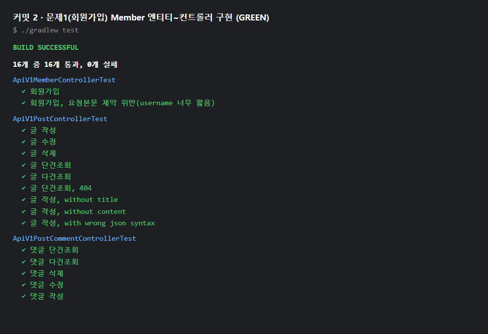

### 커밋 3: username 중복 시 409 테스트 추가 (RED)

**변경 파일**: `ApiV1MemberControllerTest.java`에 `t3` 추가

- 먼저 `memberService.join("dupUser", ...)`로 회원을 하나 만들어 둡니다(준비 단계).
- 같은 username `dupUser`로 가입 API를 호출합니다.
- 기대 결과: 상태 `409 Conflict`, `resultCode` `409-1`, 메시지 `dupUser(은)는 이미 사용중인 username 입니다.`

**결과**: 실패(RED). 아직 중복 검사 코드가 없어서 그대로 저장을 시도합니다. 그러다 DB의 `unique` 제약에 걸려 `DataIntegrityViolationException`이 나고, 409가 아닌 서버 오류가 됩니다.
→ DB 제약에만 맡기면 사용자에게 친절한 메시지를 줄 수 없습니다. 저장하기 **전에** 직접 검사해야 하는 이유입니다.

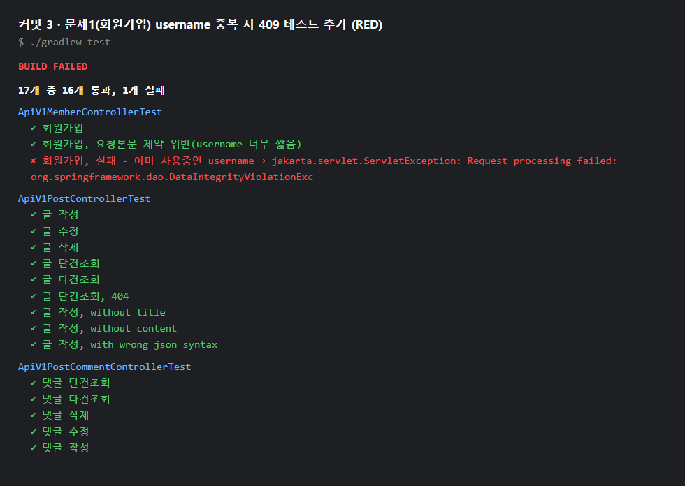

### 커밋 4: MemberDuplicateUsernameException으로 409 처리 (GREEN)

**변경 파일**

1. `global/globalExceptionHandler/GlobalExceptionHandler.java`
   - **예외 클래스 추가**: `MemberDuplicateUsernameException` (과제 명세대로 `GlobalExceptionHandler` 안에 내부 클래스로 둠)
     - 생성자에서 `"%s(은)는 이미 사용중인 username 입니다."` 메시지를 만들어 둡니다.
     - `IllegalArgumentException` 같은 일반 예외 대신 **이름만 봐도 무슨 상황인지 알 수 있는 전용 예외**를 씁니다.
   - **예외 처리기 추가**: `@ExceptionHandler(MemberDuplicateUsernameException.class)`
     - 앱 어디에서든 이 예외가 던져지면 이 메서드가 받아서 `409` + `{"resultCode": "409-1", "msg": ...}`로 바꿔 응답합니다.
   - import를 `HttpStatus.*`로 바꿔 `CONFLICT`도 쓸 수 있게 했습니다.
2. `member/service/MemberService.java`의 `join`
   ```java
   memberRepository.findByUsername(username)   // 같은 username 회원을 찾아본다
           .ifPresent(_ -> {                    // 있으면(= 중복이면)
               throw new MemberDuplicateUsernameException(username); // 예외를 던진다
           });
   ```
   - `Optional.ifPresent`는 "값이 있을 때만 실행"이라는 뜻입니다. `if (optional.isPresent())`를 짧게 쓴 형태입니다.
   - `_`는 Java 22+의 "사용하지 않는 변수" 표기입니다. 찾은 회원 객체는 쓰지 않으므로 `_`로 둡니다.

**흐름**: 컨트롤러 → `join` → 중복 발견 → 예외 → `GlobalExceptionHandler`가 409 응답

**결과**: 전체 테스트 통과(GREEN).

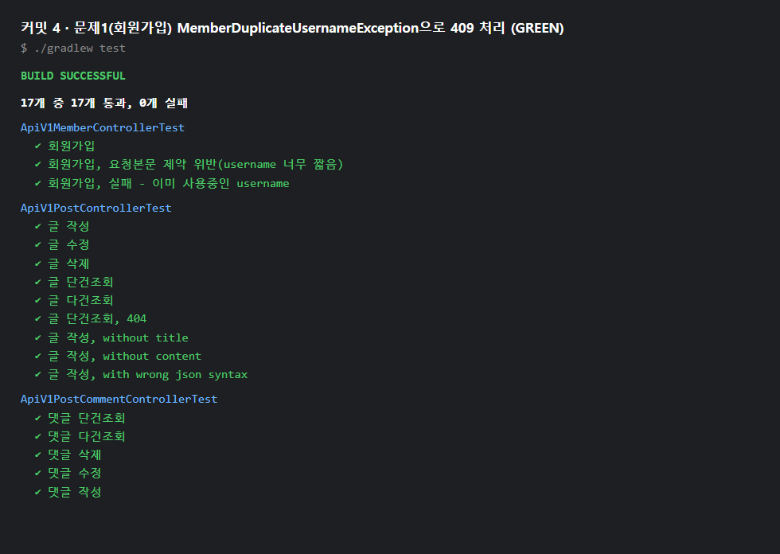

---

## 문제 2: 내 정보 API

`GET /api/v1/members/me?actorId={회원번호}`

### 커밋 5: 성공/실패 테스트 먼저 작성 (RED)

**변경 파일**: `ApiV1MemberControllerTest.java`에 `t4`, `t5`, `t6` 추가

- `t4` 내 정보 성공
  - 회원을 하나 가입시키고, 그 회원 번호를 `actorId`로 넘깁니다. `.param("actorId", ...)`는 주소 뒤에 `?actorId=...`를 붙입니다.
  - 응답 JSON에 `id`, `createDate`, `updateDate`, `username`, `name`이 있어야 합니다.
  - `jsonPath("$.password").doesNotExist()`: **비밀번호는 응답에 절대 나오면 안 됩니다.**
- `t5` 존재하지 않는 actorId(`999999`) → `401` / `401-1` / `로그인 후 이용해주세요.`
- `t6` actorId 자체가 없음 → 똑같이 `401`

**결과**: 3개 실패(RED). `/api/v1/members/me` 주소를 처리하는 메서드가 아직 없어서 404가 나옵니다.

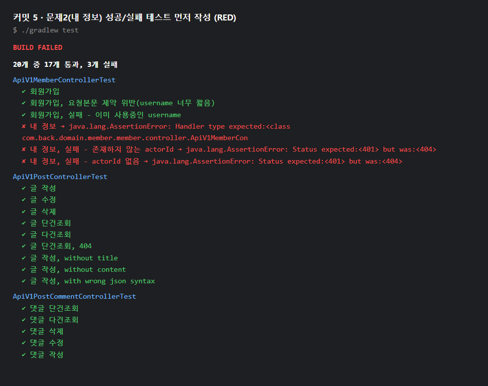

### 커밋 6: MemberDto와 UnauthenticatedException으로 구현 (GREEN)

**변경 파일**

1. `member/dto/MemberDto.java` (새 파일)
   - 응답 전용 객체입니다. `id, createDate, updateDate, username, name`만 가지고 **`password`는 일부러 빼 두었습니다.**
   - `Member` 엔티티를 그대로 반환하면 JSON에 비밀번호가 포함됩니다. 그래서 DTO로 필요한 정보만 골라서 내보냅니다.
   - 명세의 키 이름이 `updateDate`라서 엔티티의 `modifyDate` 값을 `updateDate`로 옮겨 담습니다.
2. `global/globalExceptionHandler/GlobalExceptionHandler.java`
   - `UnauthenticatedException` 예외 클래스(메시지 `로그인 후 이용해주세요.`)와, 이를 `401` / `401-1`로 바꾸는 처리기를 추가했습니다.
3. `member/service/MemberService.java`에 `getActor(Integer actorId)` 추가
   ```java
   if (actorId == null) throw new UnauthenticatedException();  // actorId를 안 보냈으면 401
   return memberRepository.findById(actorId)
           .orElseThrow(UnauthenticatedException::new);         // 그런 회원이 없으면 401
   ```
   - "요청한 사람(actor)이 누구인지 확인"하는 **공통 메서드**입니다. 이후 글/댓글 작성·수정·삭제에서도 재사용합니다.
   - `orElseThrow`: Optional이 비어 있으면 예외를 던지고, 값이 있으면 꺼내 줍니다.
4. `member/controller/ApiV1MemberController.java`에 `me` 추가
   ```java
   @GetMapping("/me")
   public MemberDto me(@RequestParam(required = false) Integer actorId) {
   ```
   - `@RequestParam`은 주소의 `?actorId=1`을 메서드 파라미터로 받습니다.
   - `required = false`로 둔 이유: 기본값(`true`)이면 actorId를 빠뜨렸을 때 스프링이 **400**을 먼저 내버립니다. 명세는 401이므로 일단 받고 `getActor`에서 직접 null을 검사합니다.
   - 타입을 `int`가 아니라 `Integer`로 둔 이유: `int`는 null을 담을 수 없습니다.

**결과**: 전체 테스트 통과(GREEN).

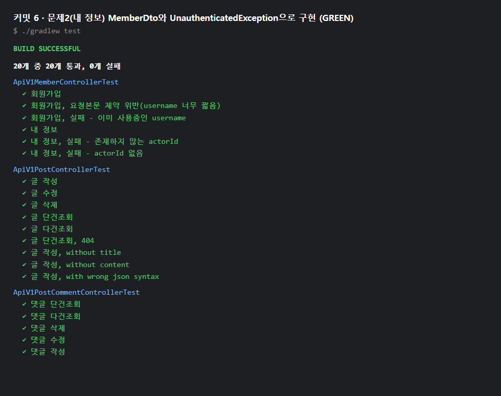

---

## 문제 3: 샘플 데이터 생성할 때 회원 6명도 만든다

### 커밋 7: 회원 6명 생성 여부 테스트 먼저 작성 (RED)

**변경 파일**: `src/test/java/com/back/global/initData/BaseInitDataTest.java` (새 파일)

- 앱이 시작될 때 `BaseInitData`가 샘플 데이터를 만듭니다. 테스트에서도 앱이 뜨므로 샘플 데이터가 생깁니다.
- 기대값을 `{username, name}` 2차원 배열로 적고, for문으로 하나씩 확인합니다.
  - `findByUsername(username).get()`: 회원을 찾습니다. 없으면 `get()`에서 예외가 나서 테스트가 실패합니다.
  - 이름과 비밀번호(`12345678`)가 맞는지 확인합니다.
- 과제 원문의 `user3(유저4)`는 오타로 보고 `user4(유저4)`로 처리했습니다.

**결과**: 실패(RED). 샘플 데이터에 아직 회원 생성 코드가 없어서 `system`을 찾지 못합니다(`NoSuchElementException`).

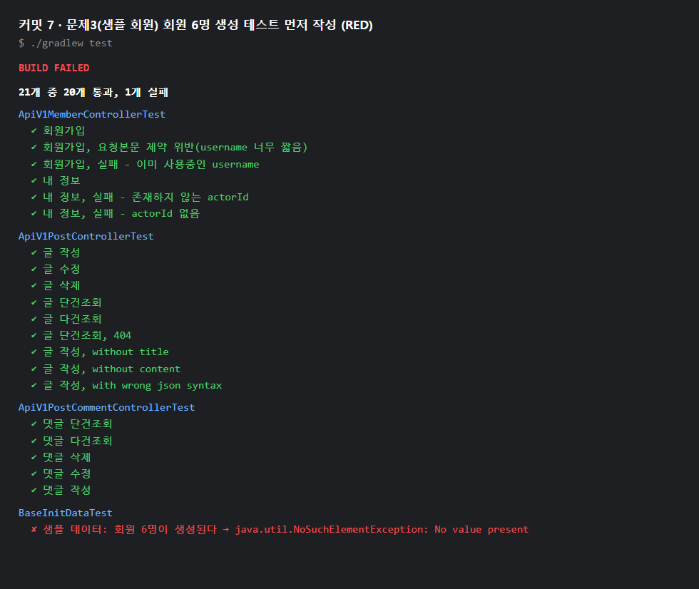

### 커밋 8: BaseInitData에 회원 6명 생성 추가 (GREEN)

**변경 파일**: `global/initData/BaseInitData.java`

- `work1()`이 **회원 6명 생성**을 맡습니다. `memberService.count() > 0`이면 이미 만들어 둔 것이므로 건너뜁니다(앱을 재시작해도 중복 생성 안 됨).
- 원래 글/댓글을 만들던 코드는 `work2()`로 옮겼습니다.
- 실행 순서 `self.work1(); self.work2();`: 회원이 먼저 있어야 다음 문제에서 글/댓글의 **작성자**로 지정할 수 있기 때문입니다.
- 왜 `this.work1()`이 아니라 `self.work1()`인가요?
  - `@Transactional`은 스프링이 만든 **프록시(대리 객체)** 를 거쳐 호출할 때만 동작합니다.
  - 같은 클래스 안에서 `this`로 바로 부르면 프록시를 건너뛰어 트랜잭션이 적용되지 않습니다. 그래서 `@Lazy`로 주입받은 자기 자신(`self`, 프록시)을 통해 호출합니다(068 코드에서 쓰던 방식).

**결과**: 전체 테스트 통과(GREEN).

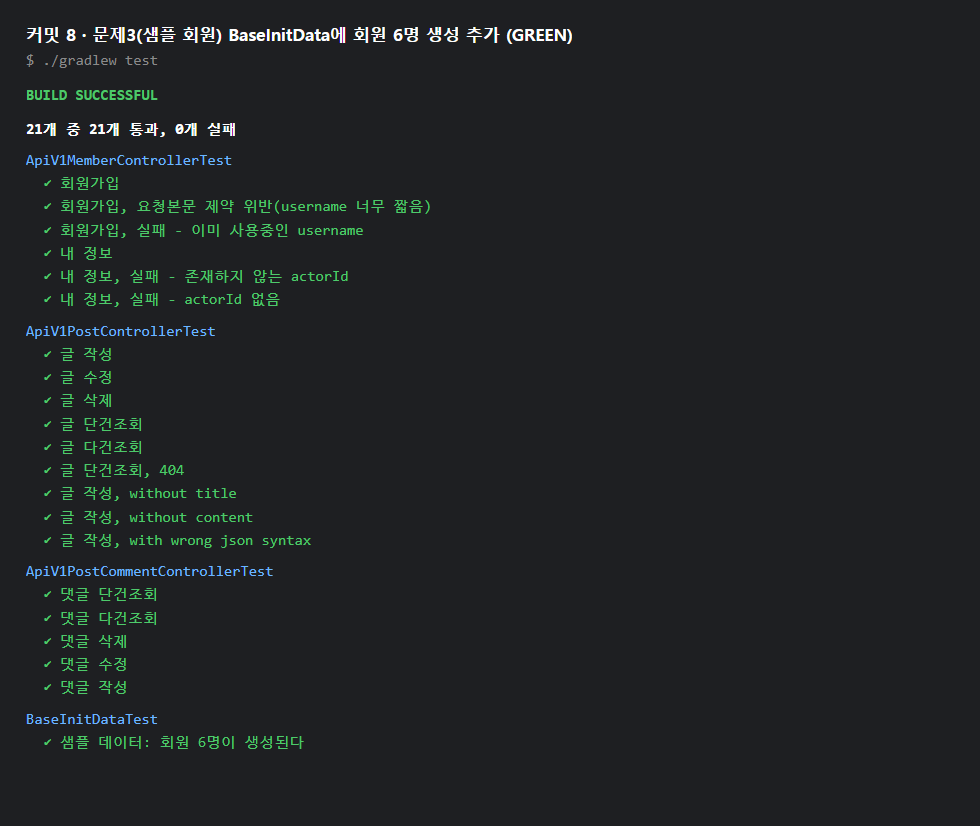

---

## 문제 4: 모든 글과 댓글은 작성자(author 필드)를 가진다

### 커밋 9: 글/댓글 작성자 테스트 먼저 작성 (RED)

**변경 파일**: `BaseInitDataTest.java`에 `t2`, `t3` 추가

- 클래스에 `@AutoConfigureMockMvc`와 `MockMvc mvc`를 추가했습니다(t3에서 API를 호출하기 위해).
- `t2` 샘플 데이터 작성자 확인
  - 글 1~3의 작성자 username이 차례로 `user1, user2, user3`인지 확인합니다.
  - 1번 글의 댓글 3개와 2번 글의 댓글 2개를 리스트 하나에 모읍니다.
  - `.extracting(c -> c.getAuthor().getUsername())`로 작성자 username만 뽑아 `containsExactly("user1", "user2", "user3", "user1", "user2")`인지 확인합니다. 순서까지 정확히 같아야 통과합니다.
- `t3` API 응답 확인
  - 글 단건 조회와 댓글 단건 조회 응답 JSON에 `authorId`, `authorName`이 있어야 합니다.

**결과**: `Post`와 `PostComment`에 `getAuthor()`가 없어서 컴파일 실패(RED).

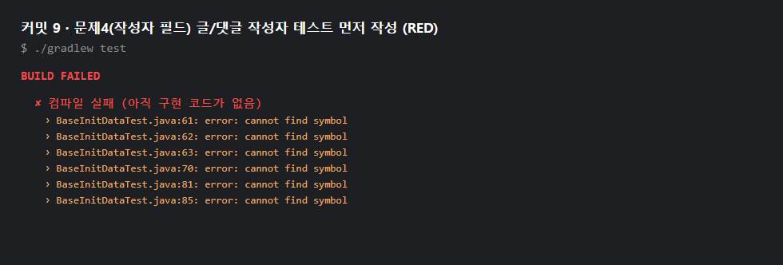

### 커밋 10: Post/PostComment에 author 추가 (GREEN)

**변경 파일**

| 파일 | 변경 내용 |
|---|---|
| `post/entity/Post.java` | `@ManyToOne(fetch = LAZY) Member author` 필드 추가. 생성자 `Post(author, title, content)`, `addComment(author, content)` |
| `postComment/entity/PostComment.java` | `Member author` 필드 추가. 생성자 `PostComment(author, post, content)` |
| `post/service/PostService.java` | `write(author, title, content)`, `writeComment(author, post, content)`로 작성자를 받음 |
| `post/dto/PostDto.java`, `postComment/dto/PostCommentDto.java` | 응답에 `authorId`, `authorName` 추가 |
| `global/initData/BaseInitData.java` | 샘플 글/댓글을 만들 때 user1~3을 작성자로 지정 |
| `ApiV1PostController.java`, `ApiV1PostCommentController.java` | 작성 API가 임시로 `system` 회원을 작성자로 사용 |

**핵심 개념**

- `@ManyToOne`: "여러 글(Many)이 한 회원(One)에 속한다." DB `post` 테이블에 `author_id` 컬럼(외래키)이 생기고, 그 값이 `member.id`를 가리킵니다.
- `fetch = LAZY`(지연 로딩): 글을 조회할 때 작성자 정보는 바로 가져오지 않습니다. `post.getAuthor().getName()`처럼 **실제로 쓸 때** DB에서 가져옵니다. 필요 없는 조회를 줄이는 설정입니다.
- 응답에는 `Member` 객체 전체가 아니라 `authorId`, `authorName`만 담습니다(커밋 6에서 본 것처럼 password 노출 방지).
- **임시 코드**: 이번 문제는 "작성자 필드 추가"까지입니다. 글/댓글 작성 API는 아직 actorId를 받지 않으므로 잠시 `system` 회원을 작성자로 넣었습니다. 문제 5, 6에서 actorId로 바꿉니다.

**결과**: 전체 테스트 통과(GREEN).

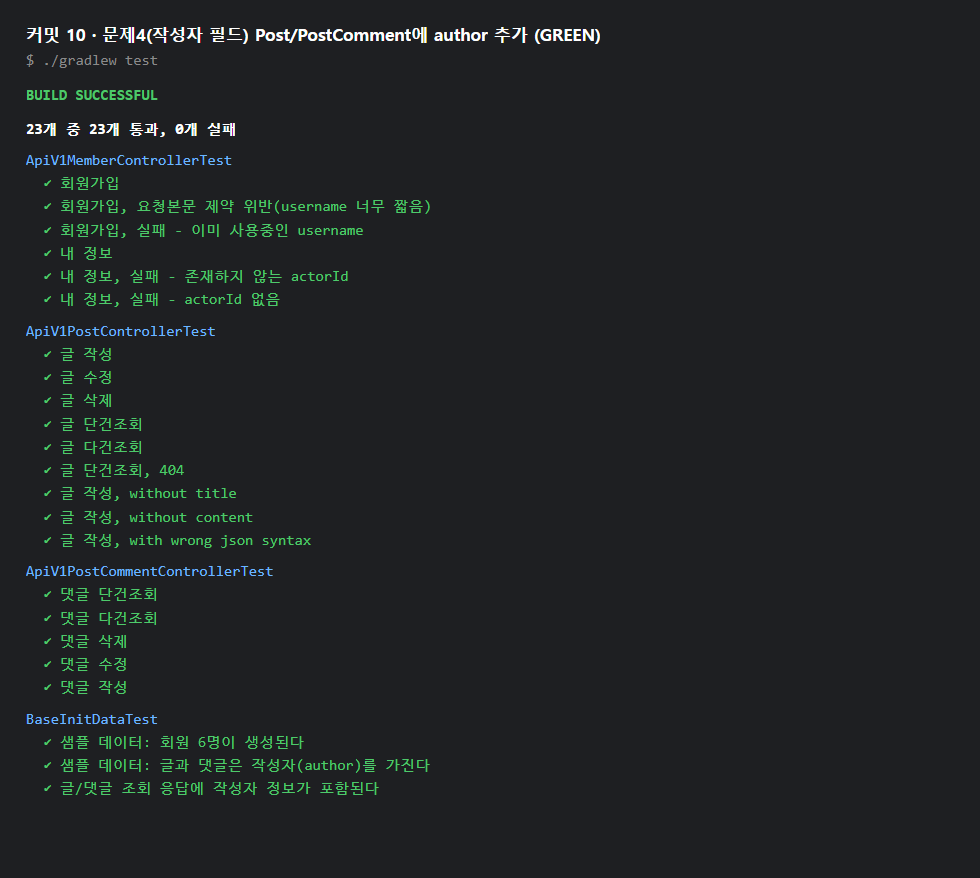

---

## 문제 5: 글 작성 시 작성자 정보가 필요하다

`POST /api/v1/posts?actorId={작성자-번호}`

### 커밋 11: 테스트 먼저 작성 (RED)

**변경 파일**: `ApiV1PostControllerTest.java`

- 테스트에 `MemberService`를 주입받습니다(샘플 회원 `user1`을 꺼내기 위해).
- `t1` 글 작성 성공을 수정했습니다.
  - `.param("actorId", user1의 번호)`로 요청합니다.
  - 응답의 `authorId`가 user1의 번호이고 `authorName`이 `유저1`인지 확인합니다.
- `t1_2` actorId 없음 → `401` / `401-1` / `로그인 후 이용해주세요.`
- `t1_3` 존재하지 않는 actorId(`999999`) → `401`

**결과**: 3개 실패(RED). 컨트롤러가 아직 actorId를 보지 않고 임시 코드대로 `system`을 작성자로 넣습니다. 그래서 작성자가 다르게 나오고, actorId가 없어도 201로 성공해 버립니다.

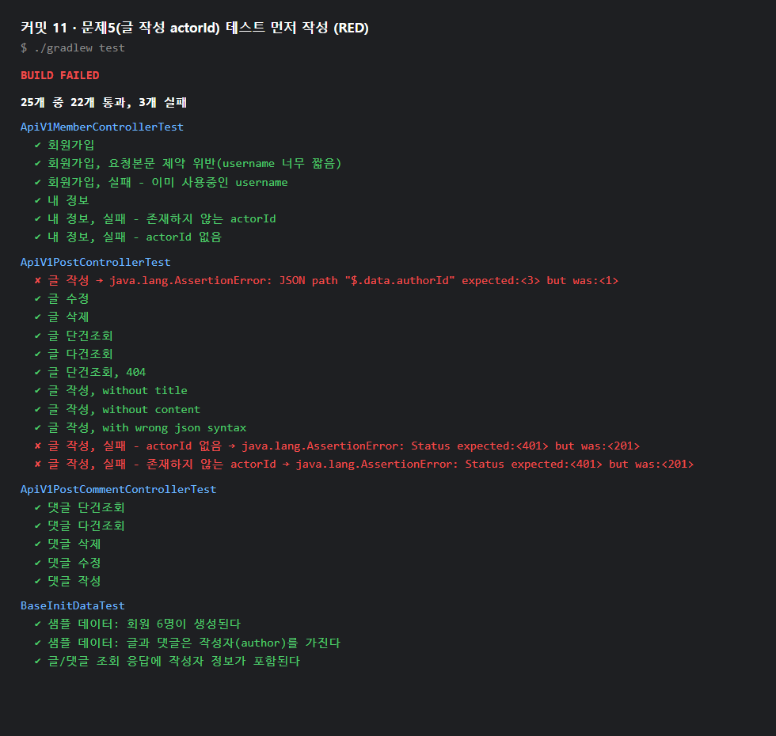

### 커밋 12: getActor로 작성자 지정 (GREEN)

**변경 파일**: `post/controller/ApiV1PostController.java`의 `write`

```java
public RsData<PostDto> write(
        @RequestParam(required = false) Integer actorId,   // ?actorId=3 을 받는다 (없으면 null)
        @RequestBody @Valid PostWriteReqBody reqBody
) {
    Member actor = memberService.getActor(actorId);        // 없거나 잘못된 actorId면 여기서 401
    Post post = postService.write(actor, reqBody.title, reqBody.content); // 요청한 회원을 작성자로 저장
```

- 커밋 10의 임시 코드(`system` 회원 사용)를 지웠습니다.
- 문제 2에서 만든 `getActor`를 **그대로 재사용**합니다. 공통 메서드로 빼 둔 효과가 여기서 나타납니다.
- 참고: `@Valid` 검사는 메서드 본문보다 먼저 실행됩니다. 그래서 제목이 비어 있으면 actorId 검사보다 먼저 `400`이 나옵니다. 기존 400 테스트들이 그대로 통과하는 이유입니다.

**결과**: 전체 테스트 통과(GREEN).

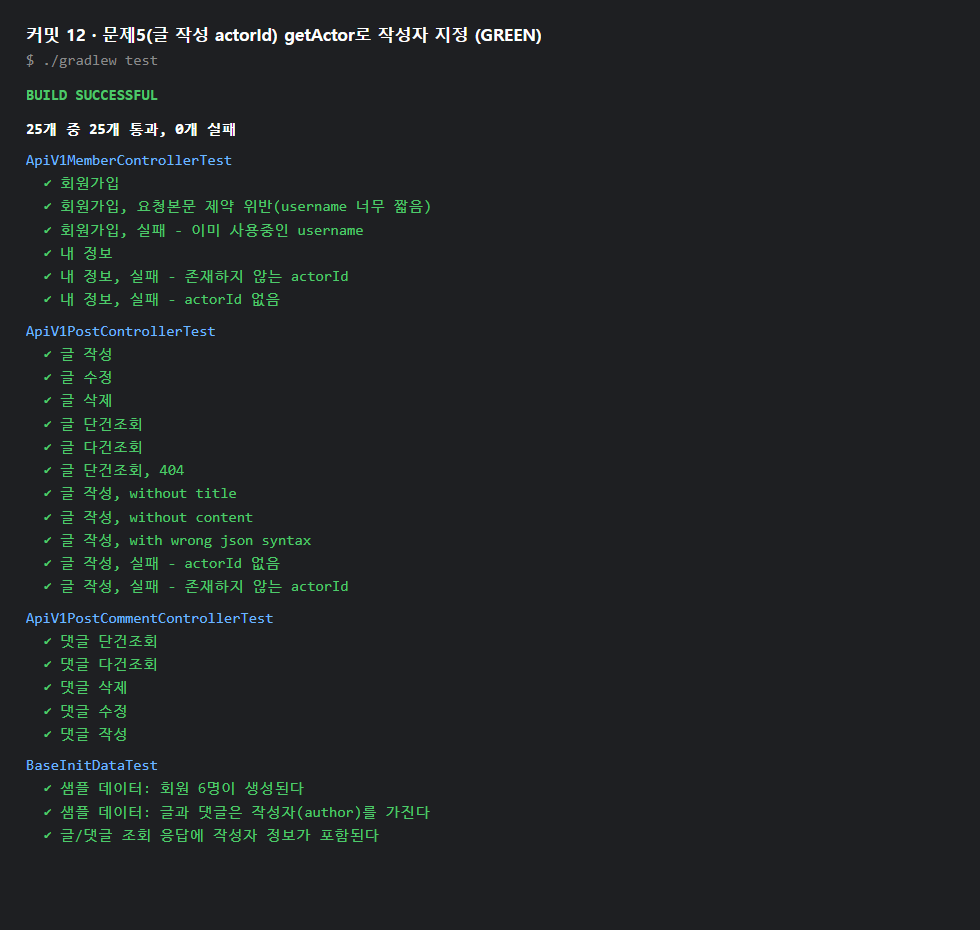

---

## 문제 6: 댓글 작성 시 작성자 정보가 필요하다

`POST /api/v1/posts/{글-번호}/comments?actorId={작성자-번호}`

### 커밋 13: 테스트 먼저 작성 (RED)

**변경 파일**: `ApiV1PostCommentControllerTest.java`

문제 5와 같은 패턴을 댓글에 적용합니다.

- `t5` 댓글 작성 성공: `user2`의 번호를 actorId로 보냅니다. 응답의 `authorId`와 `authorName`(`유저2`)을 확인합니다.
- `t5_2` actorId 없음 → `401`
- `t5_3` 존재하지 않는 actorId → `401`

**결과**: 3개 실패(RED). 댓글 작성 API는 아직 임시 코드대로 `system`을 작성자로 넣습니다.

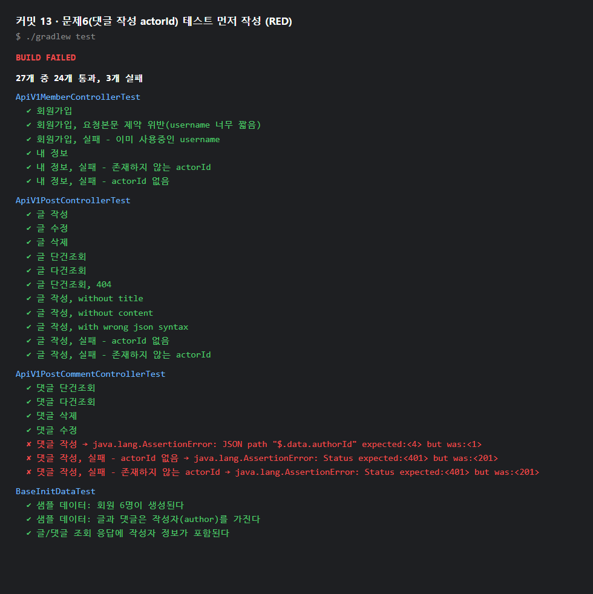

### 커밋 14: getActor로 작성자 지정 (GREEN)

**변경 파일**: `postComment/controller/ApiV1PostCommentController.java`의 `write`

```java
@PathVariable int postId,                              // 주소의 {글-번호}
@RequestParam(required = false) Integer actorId,       // ?actorId= 값
...
Member actor = memberService.getActor(actorId);        // 요청자 확인을 가장 먼저 (실패 시 401)
Post post = postService.findById(postId).get();
PostComment postComment = postService.writeComment(actor, post, reqBody.content);
```

- 커밋 10의 임시 코드(`system` 작성자)를 지웠습니다.
- `getActor`를 글 조회보다 **먼저** 호출합니다. 로그인하지 않은 사람에게는 글이 있는지 없는지(404)보다 "로그인 후 이용해주세요"(401)를 먼저 알려 주는 것이 자연스럽기 때문입니다.

**결과**: 전체 테스트 통과(GREEN).

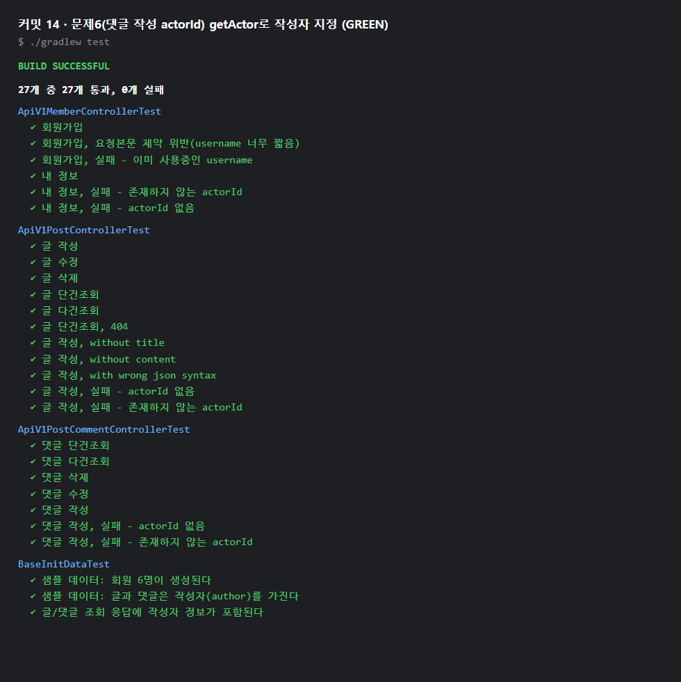

---

## 문제 7: 글 삭제 시 작성자 본인이어야 한다

`DELETE /api/v1/posts/{글-번호}?actorId={작성자-번호}`

### 커밋 15: 테스트 먼저 작성 (RED)

**변경 파일**: `ApiV1PostControllerTest.java`

- `t3` 글 삭제 성공: 1번 글의 작성자인 `user1`이 삭제하면 `200-1`입니다.
- `t3_2` 작성자가 아님: `user2`가 1번 글을 삭제하려 하면 `403` / `403-1` / `권한이 없습니다.` 또 `postService.findById(1)`로 **글이 실제로 남아 있는지**도 확인합니다(응답만 403이고 글은 지워지는 버그를 막기 위해).
- `t3_3` actorId 없음 → `401`

**결과**: 2개 실패(RED). 아직 권한 검사가 없어서 남의 글도 지워지고, actorId 없이도 지워집니다.

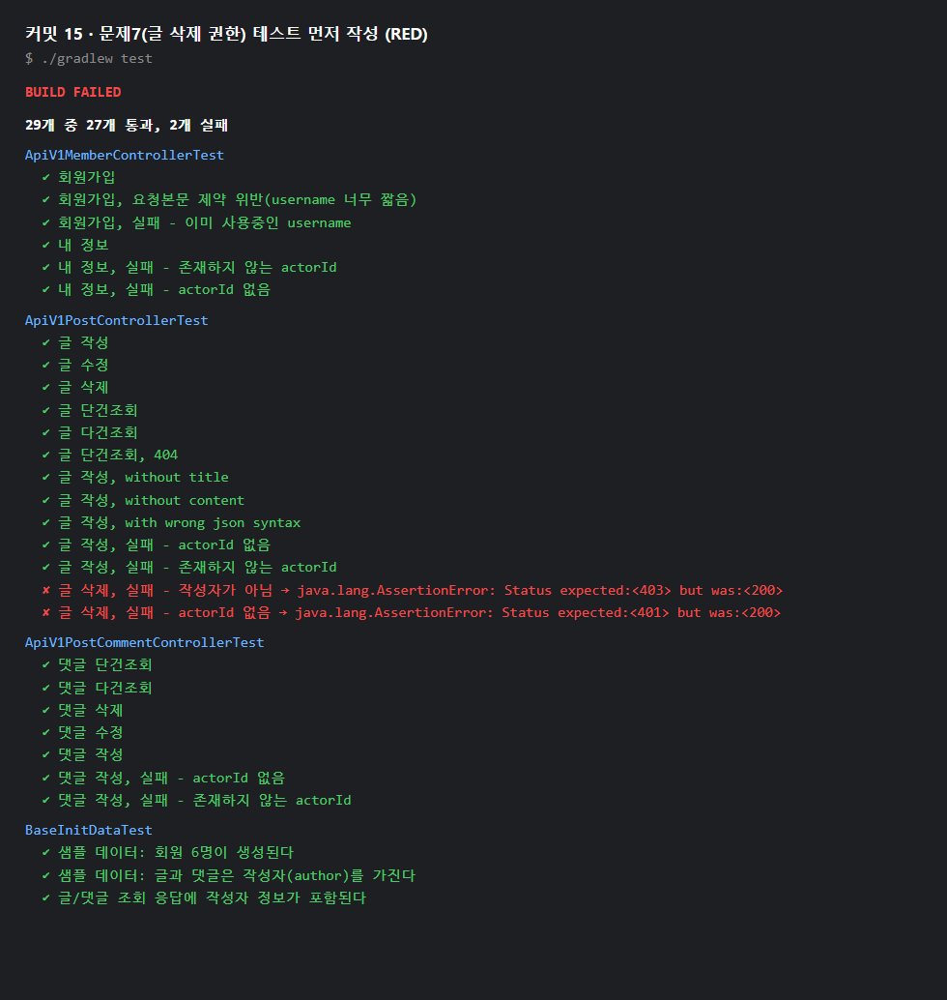

### 커밋 16: AccessDeniedException으로 403 처리 (GREEN)

**변경 파일**

1. `global/globalExceptionHandler/GlobalExceptionHandler.java`
   - `AccessDeniedException`(메시지 `권한이 없습니다.`)과, 이를 `403` / `403-1`로 바꾸는 처리기를 추가했습니다.
2. `post/entity/Post.java`에 `checkActorCanDelete(Member actor)` 추가
   ```java
   if (author.getId() != actor.getId()) throw new AccessDeniedException();
   ```
   - "이 글을 지울 수 있는가?"는 **글 자신이 가장 잘 아는 규칙**이라 엔티티에 메서드로 두었습니다. 컨트롤러가 짧아지고, 수정 권한 등에서 같은 방식을 재사용할 수 있습니다.
   - `equals` 대신 **id로 비교**합니다. `author`는 `LAZY`라서 실제 `Member`가 아닌 프록시(대리 객체)일 수 있습니다. 그런데 `BaseEntity.equals`는 클래스까지 같아야 같다고 보므로, 프록시와 실제 객체를 비교하면 틀린 결과가 나올 수 있습니다.
3. `post/controller/ApiV1PostController.java`의 `delete`
   ```java
   Member actor = memberService.getActor(actorId);   // ① 누구인지 확인 → 실패 시 401
   Post post = postService.findById(id).get();
   post.checkActorCanDelete(actor);                   // ② 본인 글인지 확인 → 아니면 403
   postService.delete(post);                          // ③ 통과했을 때만 삭제
   ```

**결과**: 전체 테스트 통과(GREEN).

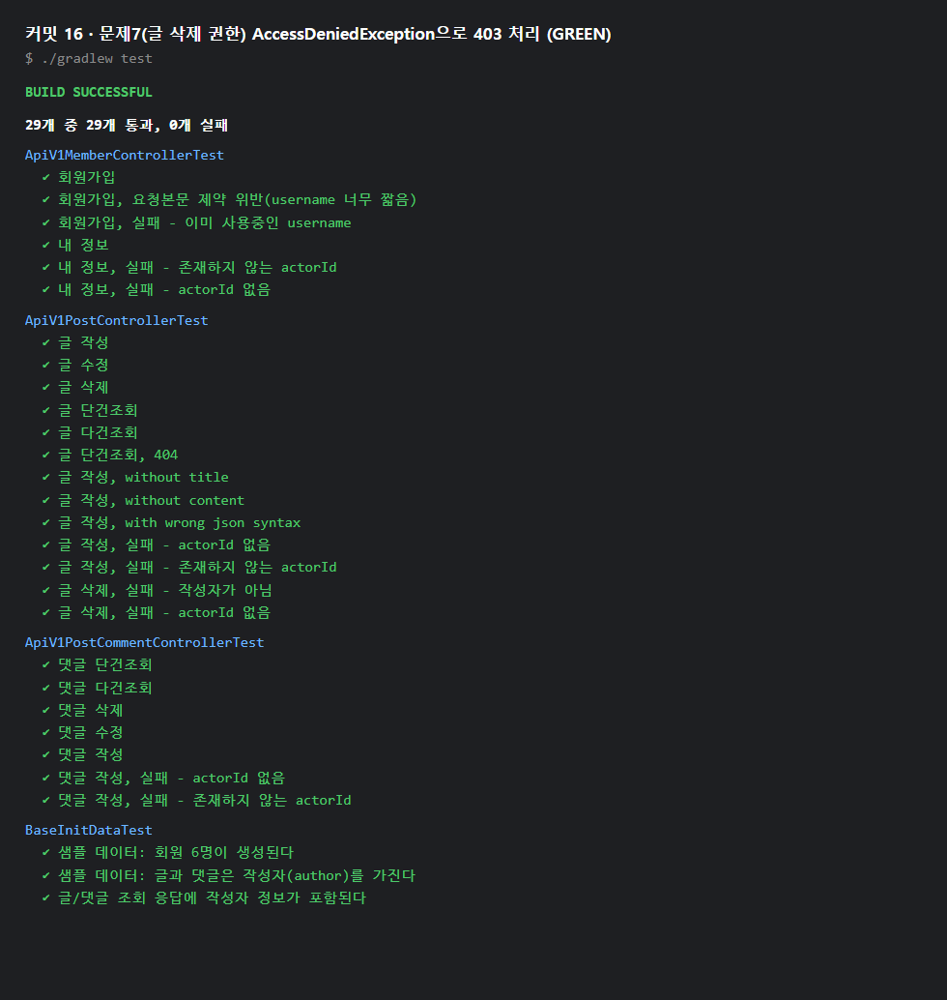

---

## 문제 8: 글 수정 시 작성자 본인이어야 한다

`PUT /api/v1/posts/{글-번호}?actorId={작성자-번호}`

### 커밋 17: 테스트 먼저 작성 (RED)

**변경 파일**: `ApiV1PostControllerTest.java`

문제 7(삭제)과 같은 패턴입니다.

- `t2` 글 수정 성공: 작성자 `user1`이 수정하면 `200-1`
- `t2_2` 작성자가 아님: `user2`가 수정하려 하면 `403-1`. 이어서 제목이 여전히 `제목 1`인지(**실제로 바뀌지 않았는지**) 확인합니다.
- `t2_3` actorId 없음 → `401`

**결과**: 2개 실패(RED). 아직 수정 API에 권한 검사가 없습니다.

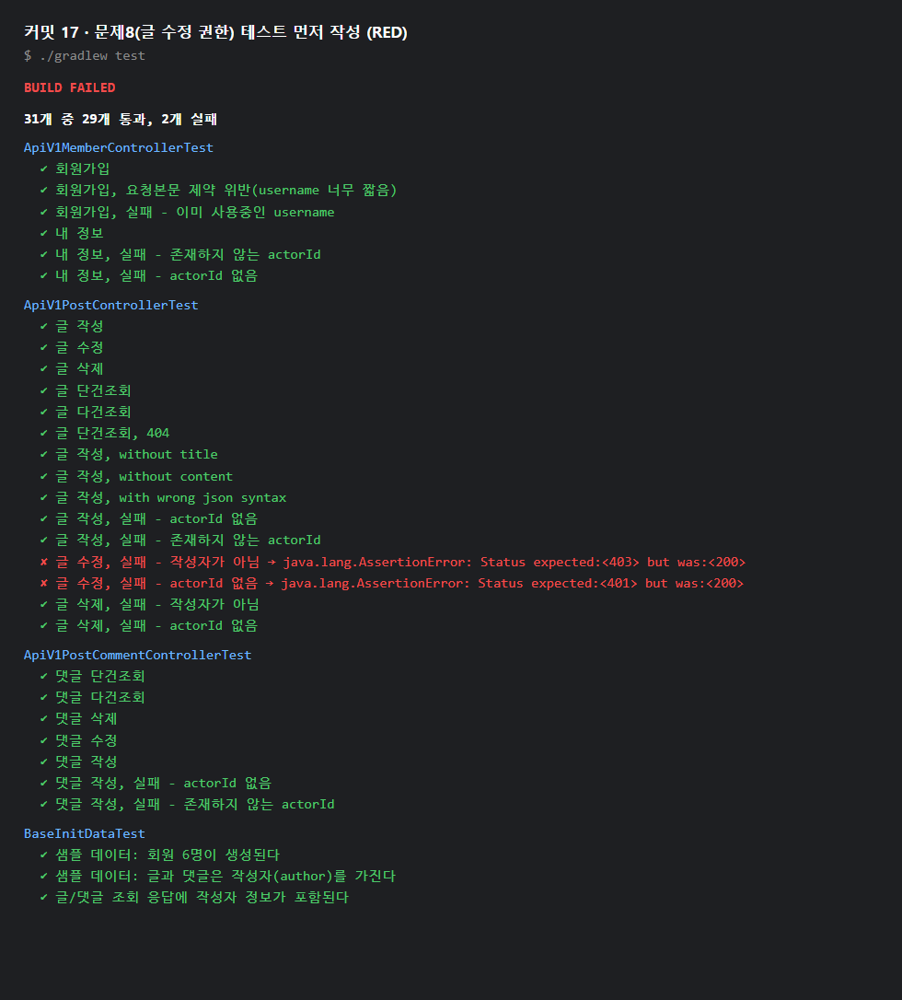

### 커밋 18: checkActorCanModify로 403 처리 (GREEN)

**변경 파일**

1. `post/entity/Post.java`에 `checkActorCanModify(Member actor)` 추가
   - 지금은 삭제 규칙과 같습니다(작성자 본인만). 하지만 "관리자는 삭제만 가능"처럼 나중에 규칙이 달라질 수 있어서 메서드를 따로 두었습니다.
2. `post/controller/ApiV1PostController.java`의 `modify`
   ```java
   Member actor = memberService.getActor(actorId);   // ① 누구인지 → 401
   Post post = postService.findById(id).get();
   post.checkActorCanModify(actor);                   // ② 본인 글인지 → 403
   postService.modify(post, reqBody.title, reqBody.content); // ③ 통과 시 수정
   ```

**결과**: 전체 테스트 통과(GREEN).

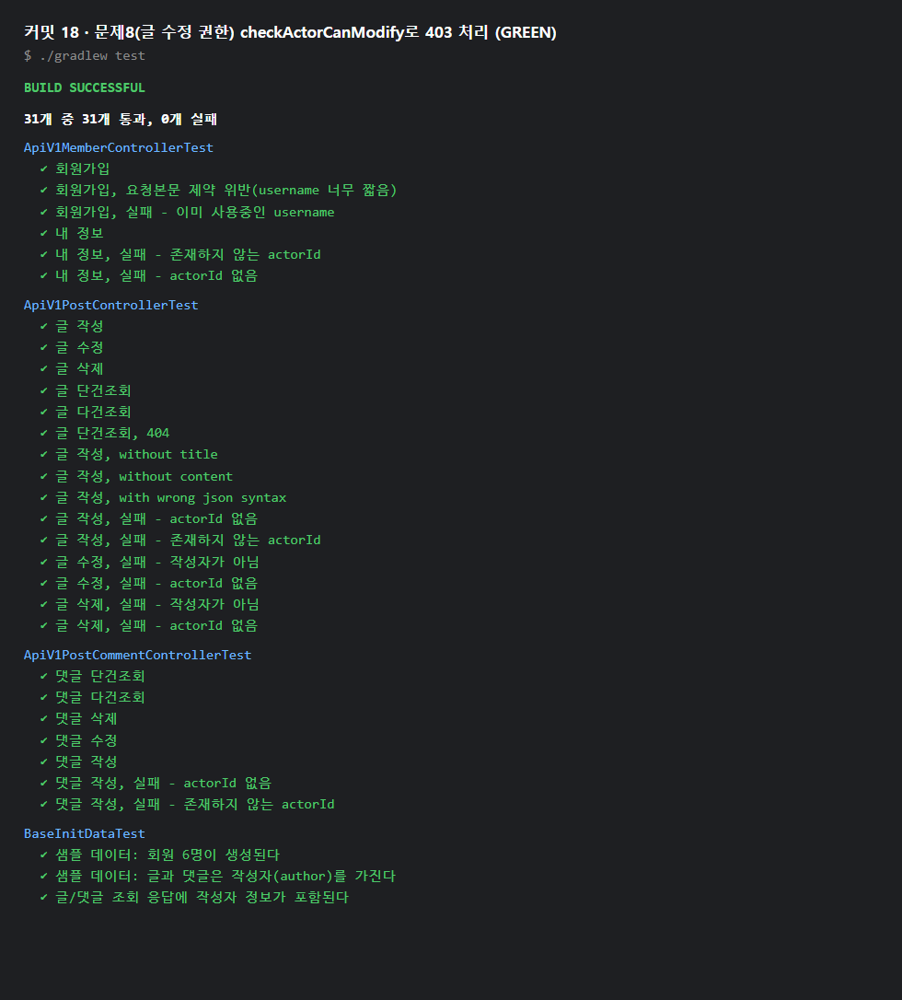

---

## 문제 9: 댓글 삭제 시 작성자 본인이어야 한다

`DELETE /api/v1/posts/{글-번호}/comments/{댓글-번호}?actorId={작성자-번호}`

### 커밋 19: 테스트 먼저 작성 (RED)

**변경 파일**: `ApiV1PostCommentControllerTest.java`

글 삭제(문제 7)와 같은 패턴을 댓글에 적용합니다.

- `t3` 1번 댓글의 작성자 `user1`이 삭제 → `200-1`
- `t3_2` `user2`가 삭제 시도 → `403-1`, 그리고 댓글이 **실제로 남아 있는지** `findCommentById(1)`로 확인
- `t3_3` actorId 없음 → `401`

**결과**: 2개 실패(RED).

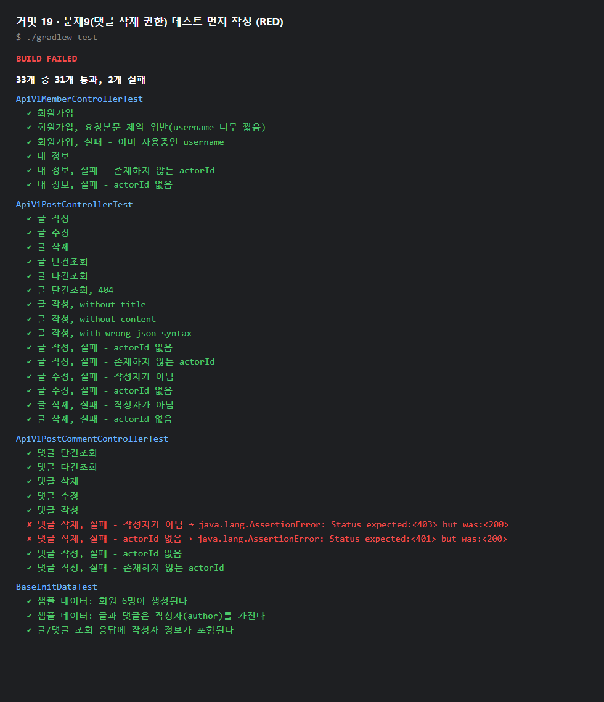

### 커밋 20: checkActorCanDelete로 403 처리 (GREEN)

**변경 파일**

1. `postComment/entity/PostComment.java`에 `checkActorCanDelete(Member actor)` 추가: 댓글 작성자 id와 요청자 id가 다르면 `AccessDeniedException`(403)
2. `postComment/controller/ApiV1PostCommentController.java`의 `delete`
   ```java
   Member actor = memberService.getActor(actorId);      // ① 누구인지 → 401
   Post post = postService.findById(postId).get();
   PostComment postComment = post.findCommentById(id).get();
   postComment.checkActorCanDelete(actor);               // ② 댓글 작성자인지 → 403
   postService.deleteComment(post, postComment);         // ③ 통과 시 삭제
   ```
   - 권한은 **글 작성자가 아니라 댓글 작성자** 기준입니다. 그래서 `post`가 아닌 `postComment`에 검사 메서드를 두었습니다.

**결과**: 전체 테스트 통과(GREEN).

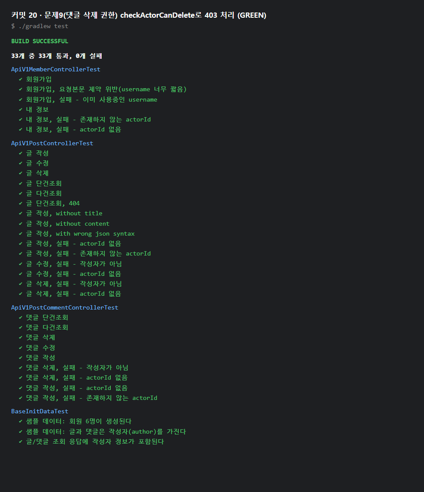
